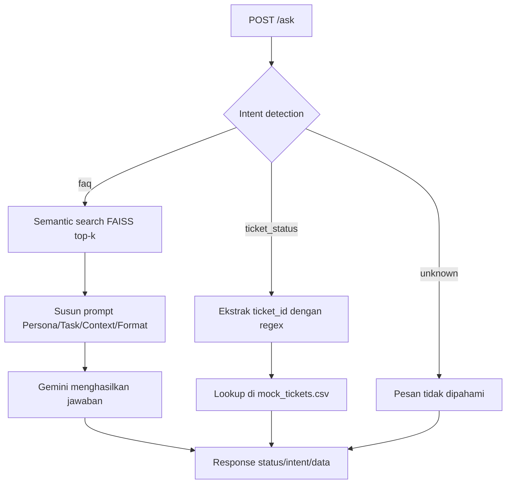

# IT Helpdesk Assistant — RAG + Mini-Agent API

Backend API untuk asisten helpdesk internal yang menggabungkan **RAG** (menjawab pertanyaan kebijakan dari knowledge base) dan **workflow routing sederhana / mini-agent** (mengecek status tiket lewat tool call) dalam satu endpoint `/ask`. Dibangun dengan Python, FastAPI, FAISS, Gemini API, dan dikemas dengan Docker.

Assignment 4 — AI Engineering Bootcamp: *End-to-End RAG & AI Agent Development*.

## Daftar Isi

1. [Problem Statement](#1-problem-statement)
2. [Desain Workflow](#2-desain-workflow)
3. [Struktur Project](#3-struktur-project)
4. [Konfigurasi (Environment Variables)](#4-konfigurasi-environment-variables)
5. [Menjalankan Aplikasi](#5-menjalankan-aplikasi)
6. [Referensi API](#6-referensi-api)
7. [Hasil Pengujian 5 Skenario](#7-hasil-pengujian-5-skenario)
8. [Keterbatasan Sistem](#8-keterbatasan-sistem)

---

## 1. Problem Statement

### Objective

Tim People & IT Operations menerima ratusan pertanyaan repetitif setiap hari. Tujuan project ini adalah prototype asisten AI internal yang menangani dua jenis permintaan tersebut secara otomatis dalam **satu sistem**, dan siap diserahkan ke tim infrastruktur dalam bentuk container Docker.

### Dua jenis permintaan user

| Jenis | Sifat | Contoh | Ditangani oleh |
| :-- | :-- | :-- | :-- |
| **Informasi / kebijakan** (`faq`) | Jawabannya ada di dokumen knowledge base; butuh pencarian semantik | "Berapa jatah cuti tahunan saya?", "Bagaimana cara reset password VPN?" | **RAG**: semantic search (FAISS) + jawaban LLM |
| **Cek status tiket** (`ticket_status`) | Butuh data spesifik milik satu entitas; tidak bisa dijawab lewat kemiripan makna | "Apa status tiket TICKET-0005 saya?" | **Tool call**: lookup exact-match `ticket_id` di data tiket |

Alasan dipisah: pencarian semantik mengembalikan teks yang *mirip*, bukan data yang *tepat*. Status tiket harus diambil dengan lookup deterministik, bukan ditebak dari embedding.

### Batasan dan asumsi

- Sumber data hanya dua file di folder `data/`: `it_helpdesk_knowledge_base.csv` (31 FAQ) dan `mock_tickets.csv` (15 tiket mock). Tidak ada sumber data lain.
- Format ID tiket adalah `TICKET-XXXX` (angka 1-6 digit diterima dan dinormalkan, mis. `ticket 5` menjadi `TICKET-0005`).
- Satu request berisi satu pertanyaan; tidak ada memori percakapan antar request.
- Jika dalam satu pesan ada lebih dari satu ID tiket, hanya ID pertama yang diproses.
- Bahasa utama adalah Bahasa Indonesia (keyword Inggris dasar seperti `ticket`, `status`, `check` juga dikenali).
- Tidak ada autentikasi; prototype ini tidak memverifikasi bahwa tiket benar-benar milik penanya.
- LLM dan embedding memakai Gemini API; API key dikelola lewat environment variable, tidak pernah di-hardcode.
- Deployment ke cloud berada di luar scope; aplikasi dijalankan lokal, dengan atau tanpa Docker.

---

## 2. Desain Workflow

```
                          ┌──────────────────────────┐
  POST /ask {"query"} ──► │   FastAPI  (main.py)     │
                          └────────────┬─────────────┘
                                       ▼
                          ┌──────────────────────────┐
                          │ Intent Detection         │
                          │ (router.py)              │
                          │ keyword/regex ► LLM*     │   * hanya bila ambigu
                          └──────┬─────────┬─────────┘
                    faq          │         │         ticket_status
                  ┌──────────────┘         └───────────────┐
                  ▼                                        ▼
     ┌─────────────────────────┐              ┌─────────────────────────┐
     │ RAG (rag.py)            │              │ Tool call (tools.py)    │
     │ 1. embed query          │              │ 1. extract ticket_id    │
     │ 2. FAISS top-k search   │              │ 2. lookup mock_tickets  │
     │ 3. prompt P/T/C/F       │              │ 3. format status /      │
     │ 4. Gemini → jawaban     │              │    pesan "tidak ada"    │
     └────────────┬────────────┘              └────────────┬────────────┘
                  └──────────────────┬─────────────────────┘
                                     ▼
                     {"status": ..., "intent": ..., "data": ...}
```



### Kriteria intent `faq` vs `ticket_status`

Intent dideteksi berurutan; aturan pertama yang cocok berlaku (`router.detect_intent_by_keyword`):

| # | Kondisi pada query | Intent |
| :-: | :-- | :-- |
| 1 | Query kosong / hanya spasi | `unknown` |
| 2 | Ada pola ID tiket (`TICKET-0042`, `tiket 42`, `tiket #7`) | `ticket_status` |
| 3 | Menyebut "tiket/ticket" **dan** kata status (`status`, `cek`, `progres`, `update`, `sampai mana`, ...) **tanpa** kata tanya prosedur | `ticket_status` |
| 4 | Menyebut "tiket/ticket" **dan** kata tanya prosedur (`cara`, `bagaimana`, `prosedur`, ...) | `faq` (mis. "Bagaimana cara mengajukan tiket?") |
| 5 | Menyebut "tiket/ticket" tanpa petunjuk jelas, atau "status ... saya" tanpa kata tiket | **ambigu** → diputuskan LLM |
| 6 | Selain itu | `faq` |

Prinsipnya: **intent `ticket_status` berarti user meminta data spesifik miliknya** (ada ID, atau jelas meminta cek/progres tiket), sedangkan **`faq` berarti user bertanya tentang aturan, prosedur, atau informasi umum** meskipun kata "tiket" muncul di dalam kalimat.

Mode deteksi diatur lewat `INTENT_MODE`:

- `hybrid` (default): aturan di atas dulu; LLM hanya dipanggil untuk kasus ambigu (hemat kuota dan latensi). Jika LLM gagal, fallback ke `faq`.
- `keyword`: hanya aturan (baseline tanpa LLM).
- `llm`: seluruh query diklasifikasikan LLM (`faq` / `ticket_status` / `unknown`).

### Komponen RAG

- **Unit retrievable**: satu baris FAQ (kategori + pertanyaan + jawaban) digabung jadi satu dokumen.
- **Embedding**: `gemini-embedding-001` (768 dimensi), `RETRIEVAL_DOCUMENT` untuk dokumen dan `RETRIEVAL_QUERY` untuk pertanyaan, vektor dinormalisasi L2.
- **Index**: FAISS `IndexFlatIP` (inner product pada vektor ternormalisasi = cosine similarity), dibangun **sekali saat startup**, bukan per request.
- **Prompt**: terstruktur Persona / Task / Context / Format. LLM diwajibkan menjawab hanya dari context, dan memakai kalimat penolakan baku bila jawabannya tidak ada.
- **LLM**: `gemini-3.6-flash` (model lama seperti `gemini-2.5-flash` tidak lagi tersedia untuk key baru). Konsistensi jawaban dijaga lewat prompt yang membatasi jawaban hanya dari context.

### Nilai `status` pada response

| status | Arti |
| :-- | :-- |
| `success` | Permintaan diproses (termasuk jawaban "tidak tahu" dari RAG untuk pertanyaan di luar cakupan) |
| `not_found` | Intent `ticket_status` dikenali, tetapi ID tiket tidak ada di data |
| `error` | Intent tidak dikenali, ID tiket tidak disertakan, request tidak valid, atau LLM gagal (HTTP 4xx/5xx) |

---

## 3. Struktur Project

```
.
├── app/
│   ├── main.py      # FastAPI: endpoint /ask, /health, error handling, build index saat startup
│   ├── router.py    # Intent detection + ekstraksi ticket_id + routing ke RAG / tool
│   ├── rag.py       # Index FAISS, semantic search, prompt, jawaban LLM
│   ├── tools.py     # Tool call: pencarian status tiket di mock_tickets.csv
│   └── llm.py       # Wrapper Gemini API (generate + embedding, retry, error → LLMError)
├── data/
│   ├── it_helpdesk_knowledge_base.csv
│   └── mock_tickets.csv
├── tests/
│   ├── test_offline.py     # unit test tanpa API key (pytest)
│   ├── run_scenarios.py    # skenario end-to-end ke endpoint yang berjalan
│   ├── check_key.py        # diagnosa API key dan ketersediaan model Gemini
│   └── results.md          # log hasil pengujian skenario terakhir
├── Dockerfile
├── .dockerignore
├── .env.example
├── requirements.txt / requirements-dev.txt
└── README.md
```

---

## 4. Konfigurasi (Environment Variables)

Salin `.env.example` menjadi `.env`, lalu isi `GEMINI_API_KEY` dengan key milik sendiri (dibuat di [Google AI Studio](https://aistudio.google.com/apikey)). **File `.env` sudah di-ignore oleh git dan tidak boleh di-commit.**

```bash
cp .env.example .env
```

| Variable | Default | Keterangan |
| :-- | :-- | :-- |
| `GEMINI_API_KEY` | *(wajib)* | API key Gemini |
| `USE_VERTEX_AI` | `false` | `true` bila key berasal dari Vertex AI (express mode), bukan Gemini Developer API |
| `GEMINI_MODEL` | `gemini-3.6-flash` | Model untuk jawaban RAG dan klasifikasi intent |
| `GEMINI_FALLBACK_MODELS` | `gemini-3.5-flash-lite,gemini-3.8-flash` | Model cadangan bila model utama sibuk (503) atau tidak tersedia (404) |
| `GEMINI_TEMPERATURE` | *(kosong)* | Opsional; kosong = temperature bawaan model |
| `EMBEDDING_MODEL` | `gemini-embedding-001` | Model embedding |
| `EMBEDDING_DIM` | `768` | Dimensi vektor embedding |
| `INTENT_MODE` | `hybrid` | `hybrid` / `keyword` / `llm` |
| `TOP_K` | `3` | Jumlah dokumen hasil retrieval |
| `RAG_MIN_SCORE` | `0` | Ambang cosine minimum; di bawahnya query dianggap di luar cakupan (0 = nonaktif) |

---

## 5. Menjalankan Aplikasi

### 5.1 Lokal (tanpa Docker)

Prasyarat: Python 3.10+.

```bash
python3 -m venv .venv
source .venv/bin/activate
pip install -r requirements.txt

cp .env.example .env        # lalu isi GEMINI_API_KEY
uvicorn app.main:app --reload --port 8000
```

Cek: `curl http://localhost:8000/health` → `{"status":"ok","index_ready":true}`.
Dokumentasi interaktif: <http://localhost:8000/docs>.

### 5.2 Dengan Docker

Prasyarat: Docker terpasang dan `.env` sudah diisi.

```bash
docker build -t it-helpdesk-assistant .
docker run --rm -p 8000:8000 --env-file .env it-helpdesk-assistant
```

API key diberikan saat runtime lewat `--env-file`; **tidak** ikut masuk ke image (`.env` dikecualikan lewat `.dockerignore`). Setelah container berjalan, endpoint dapat diakses dari luar container di `http://localhost:8000`.

### 5.3 Menjalankan pengujian

```bash
# Unit test offline (tanpa API key)
pip install -r requirements-dev.txt
pytest -q

# Skenario end-to-end (aplikasi harus sedang berjalan, lokal maupun Docker)
python tests/run_scenarios.py http://localhost:8000
```

### 5.4 Troubleshooting API key

Cek key dengan skrip diagnosa (key tidak pernah dicetak):

```bash
python tests/check_key.py
```

Skrip mencoba generate dan embedding lewat Gemini Developer API dan Vertex AI, lalu menyarankan nilai `USE_VERTEX_AI` yang tepat.

Key Google AI Studio terbaru berawalan `AQ.` (bukan `AIza`). Pada sebagian akun, key ini ditolak dengan `401 ACCESS_TOKEN_TYPE_UNSUPPORTED` oleh endpoint Gemini Developer API. Jika itu terjadi, coba buat key baru di project lain, atau gunakan jalur Vertex AI (`USE_VERTEX_AI=true`).

---

## 6. Referensi API

### `POST /ask`

Request:

```json
{ "query": "Apa status tiket TICKET-0005 saya?" }
```

Response (selalu berbentuk `status`, `intent`, `data`):

```json
{
  "status": "success",
  "intent": "ticket_status",
  "data": "Tiket TICKET-0005 — \"Reset password VPN gagal terus\" (kategori: Access). Status: Diproses. Update terakhir: 2026-08-27."
}
```

Contoh `curl`:

```bash
curl -X POST http://localhost:8000/ask \
  -H "Content-Type: application/json" \
  -d '{"query": "berapa jatah cuti tahunan saya?"}'
```

Penanganan error:

| Kondisi | HTTP | `status` | `intent` |
| :-- | :-: | :-- | :-- |
| Intent tidak dikenali (mis. query kosong/spasi) | 200 | `error` | `unknown` |
| Minta cek tiket tanpa menyertakan ID | 200 | `error` | `ticket_status` |
| ID tiket tidak ada di data | 200 | `not_found` | `ticket_status` |
| Body tidak valid (`query` hilang / >1000 karakter) | 422 | `error` | `unknown` |
| LLM / embedding gagal (key salah, kuota habis, jaringan) | 503 | `error` | `faq` |
| Error tak terduga | 500 | `error` | `unknown` |

### `GET /health`

Mengembalikan `{"status": "ok", "index_ready": true|false}`.

---

## 7. Hasil Pengujian 5 Skenario

Pengujian dijalankan terhadap endpoint `/ask` dengan `tests/run_scenarios.py` (model `gemini-3.6-flash`, embedding `gemini-embedding-001`). Log lengkap tersimpan di `tests/results.md`.

| # | Skenario | Query | Intent diharapkan | Intent aktual | Status | Router tepat? |
| :-: | :-- | :-- | :-- | :-- | :-- | :-: |
| 1 | RAG - kebijakan | "Berapa jatah cuti tahunan karyawan tetap?" | `faq` | `faq` | `success` | Ya |
| 2 | RAG - prosedur | "Bagaimana cara reset password VPN perusahaan?" | `faq` | `faq` | `success` | Ya |
| 3 | Tool call - tiket ada | "Apa status tiket TICKET-0005 saya?" | `ticket_status` | `ticket_status` | `success` | Ya |
| 4 | Tool call - tiket tidak ada | "Tolong cek status tiket TICKET-0042" | `ticket_status` | `ticket_status` | `not_found` | Ya |
| 5 | Di luar cakupan | "Bagaimana prediksi cuaca di Jakarta besok?" | `faq` (RAG menolak menjawab) | `faq` | `success` | Ya |
| 6 | Tambahan - cek tiket tanpa ID | "Tolong cek status tiket saya" | `ticket_status` | `ticket_status` | `error` | Ya |
| 7 | Tambahan - input hanya spasi | "   " | `unknown` | `unknown` | `error` | Ya |

**Hasil: 7/7 skenario sesuai ekspektasi routing** (5 skenario wajib + 2 skenario tambahan).

Respons aktual:

1. `{"status":"success","intent":"faq","data":"Karyawan tetap mendapat jatah 12 hari cuti tahunan yang dapat diambil setelah masa kerja minimal 3 bulan."}`
2. `{"status":"success","intent":"faq","data":"Anda dapat melakukan reset password VPN secara mandiri melalui portal self-service IT. Jika akun Anda terkunci, silakan hubungi tim IT Support untuk bantuan lebih lanjut."}`
3. `{"status":"success","intent":"ticket_status","data":"Tiket TICKET-0005 — \"Reset password VPN gagal terus\" (kategori: Access). Status: Diproses. Update terakhir: 2026-08-27."}`
4. `{"status":"not_found","intent":"ticket_status","data":"Tiket TICKET-0042 tidak ditemukan. Periksa kembali ID tiket Anda (format TICKET-XXXX) atau hubungi tim IT Support."}`
5. `{"status":"success","intent":"faq","data":"Maaf, saya tidak menemukan informasi tersebut di knowledge base. Silakan hubungi tim IT Support atau HR untuk bantuan lebih lanjut."}`
6. `{"status":"error","intent":"ticket_status","data":"Saya mendeteksi Anda ingin mengecek status tiket, tetapi ID tiket tidak ditemukan. Sertakan ID dengan format TICKET-XXXX, contoh: TICKET-0005."}`
7. `{"status":"error","intent":"unknown","data":"Maaf, saya tidak memahami permintaan Anda. Silakan ajukan pertanyaan seputar kebijakan/IT, atau sertakan ID tiket (TICKET-XXXX) untuk cek status."}`

### Pengujian di dalam container Docker

Skenario yang sama dijalankan ulang terhadap container (`docker run -p 8000:8000 --env-file .env it-helpdesk-assistant`) dari luar container, lewat `http://localhost:8000`:

- `docker build` berhasil (base image `python:3.11-slim`, dependency terinstal dari `requirements.txt`).
- Container berjalan dengan status `healthy`; log menampilkan "Index FAISS siap: 31 dokumen, dimensi 768" saat startup.
- API key hanya diberikan lewat `--env-file` saat runtime dan tidak ada di dalam image.
- Endpoint `/ask` dapat diakses dari luar container, dan **7/7 skenario sesuai ekspektasi routing**, sama seperti pengujian lokal. Jawaban RAG berbeda sedikit dalam redaksi antar-run (mis. skenario 2), tetapi isinya tetap sesuai FAQ.

### Observasi

- **Router akurat pada seluruh skenario.** Pertanyaan kebijakan masuk ke RAG; pertanyaan yang memuat ID tiket atau jelas meminta cek tiket masuk ke tool call. Tidak ada salah rute.
- **Jawaban RAG berdasar knowledge base.** Skenario 1 sesuai FAQ #1 (12 hari, minimal 3 bulan masa kerja) dan skenario 2 sesuai FAQ #8 (portal self-service IT atau tim IT Support), tanpa informasi tambahan yang dikarang.
- **Skenario 5 (di luar cakupan):** query cuaca tidak mengandung keyword tiket sehingga diteruskan ke RAG; LLM menolak menjawab dengan kalimat baku sesuai instruksi prompt, bukan berhalusinasi. Konsekuensinya, query seperti ini tetap memakai satu panggilan embedding dan satu panggilan LLM.
- **Tiket tidak ditemukan (skenario 4) tidak membuat aplikasi crash.** Status `not_found` membedakannya dari tiket yang ada, dan pesannya memberi arahan lanjutan.
- **Kasus tepi tertangani:** permintaan cek tiket tanpa ID (skenario 6) dan input kosong (skenario 7) menghasilkan pesan yang jelas tanpa memanggil LLM.
- **Latensi:** jalur tool call selesai dalam hitungan milidetik; jalur RAG sekitar 3-5 detik per request (embedding query + generasi LLM).
- **Startup:** index FAISS (31 dokumen, 768 dimensi) dibangun sekali saat startup dengan satu panggilan embedding batch, bukan per request.


---

## 8. Keterbatasan Sistem

- **Deteksi intent berbasis aturan bersifat terbatas.** Keyword dan regex menangani bahasa Indonesia dan Inggris dasar, tetapi kalimat dengan salah ketik berat, singkatan tidak umum, atau bahasa lain bisa salah rute. Kasus ambigu diserahkan ke LLM (mode `hybrid`), yang menambah satu panggilan LLM dan bergantung pada ketersediaan layanan.
- **Penolakan pertanyaan di luar cakupan bergantung pada kepatuhan LLM terhadap prompt.** `RAG_MIN_SCORE` disediakan sebagai pagar tambahan berbasis skor retrieval, tetapi nilainya belum dikalibrasi dan dinonaktifkan secara default. Query di luar cakupan tetap memakai satu panggilan embedding dan satu panggilan LLM.
- **Tidak ada autentikasi atau verifikasi kepemilikan tiket.** Siapa pun yang tahu ID tiket dapat melihat statusnya; kata "saya" pada query tidak diverifikasi.
- **Data statis dan skala kecil.** Knowledge base hanya 31 FAQ dan tiket berasal dari CSV mock. Index dibangun ulang setiap startup, sehingga startup memerlukan akses ke Gemini API (bila gagal, aplikasi tetap hidup dan mencoba lagi pada request pertama).
- **Satu giliran per request.** Tidak ada memori percakapan, sehingga pertanyaan lanjutan seperti "kalau yang sakit?" tidak dipahami. Bila satu pesan memuat beberapa ID tiket, hanya yang pertama diproses.
- **Evaluasi masih kecil.** Pengujian hanya mencakup 5 skenario wajib dan 2 tambahan; belum ada pengukuran akurasi retrieval atau intent pada set data yang lebih besar.
- **Ketergantungan pada layanan dan model Gemini yang cepat berubah.** Selama pengembangan, `gemini-2.5-flash` ditolak (404, tidak tersedia untuk key baru) dan `gemini-3.8-flash` sempat mengembalikan 503 karena lonjakan permintaan. Mitigasinya adalah model diatur lewat environment variable, ada retry, dan ada model cadangan otomatis, tetapi failover menambah latensi beberapa detik. Batas kuota free tier juga dapat memunculkan error 429.
- **Jawaban LLM tidak sepenuhnya deterministik.** Redaksi jawaban bisa sedikit berbeda antar-request meski isinya mengikuti knowledge base.
- **Format API key Google AI Studio yang baru (`AQ.`)** ditolak oleh sebagian akun dengan 401 `ACCESS_TOKEN_TYPE_UNSUPPORTED`; lihat bagian 5.4 untuk diagnosa.

